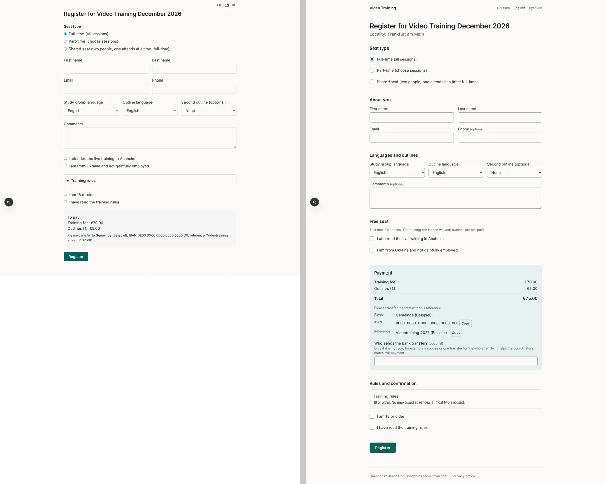
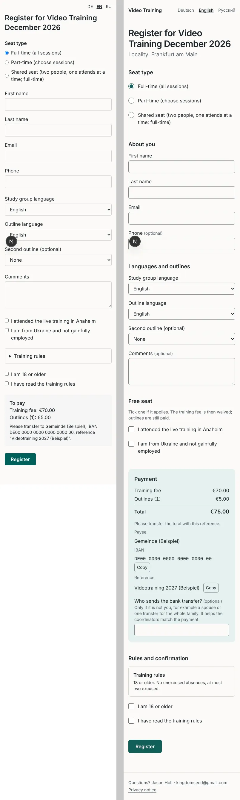
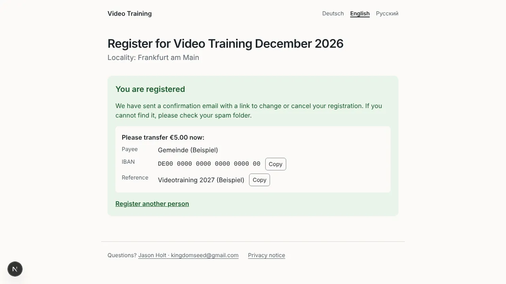
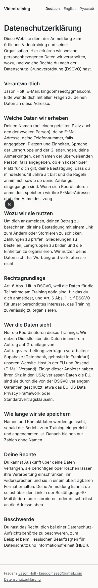
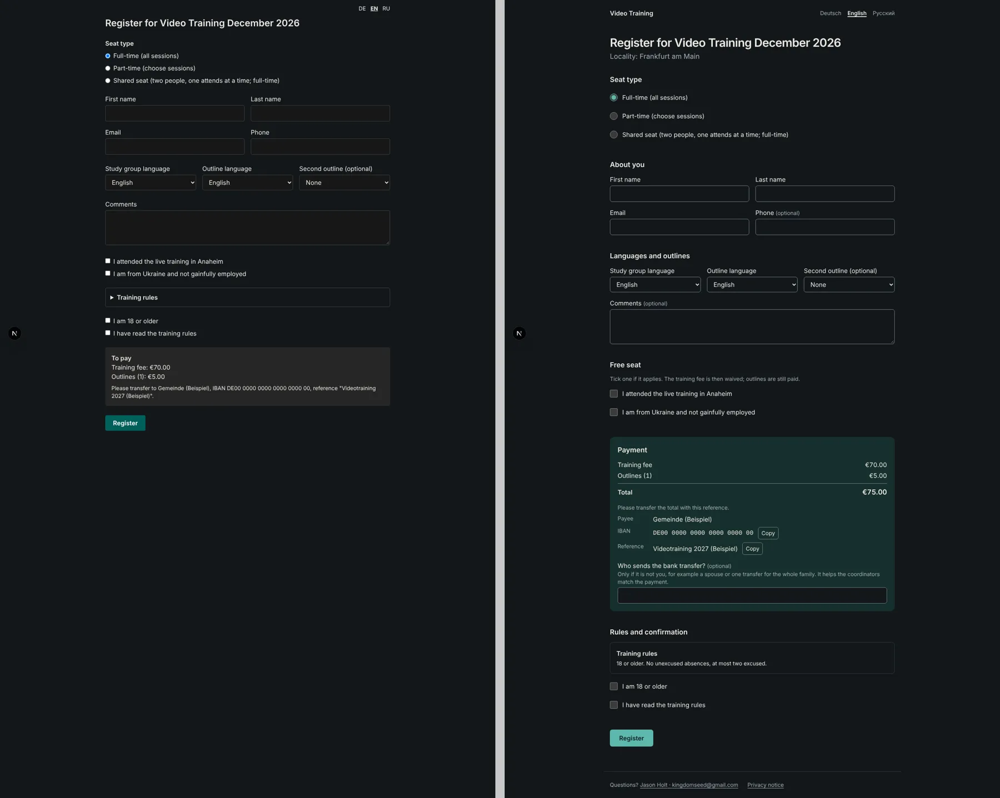
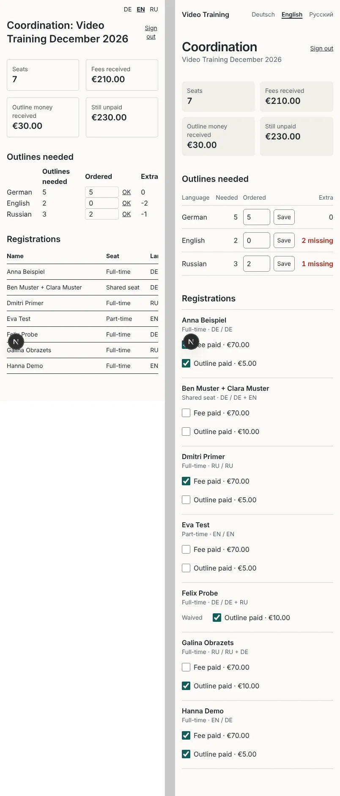
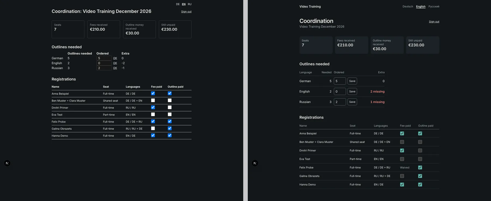
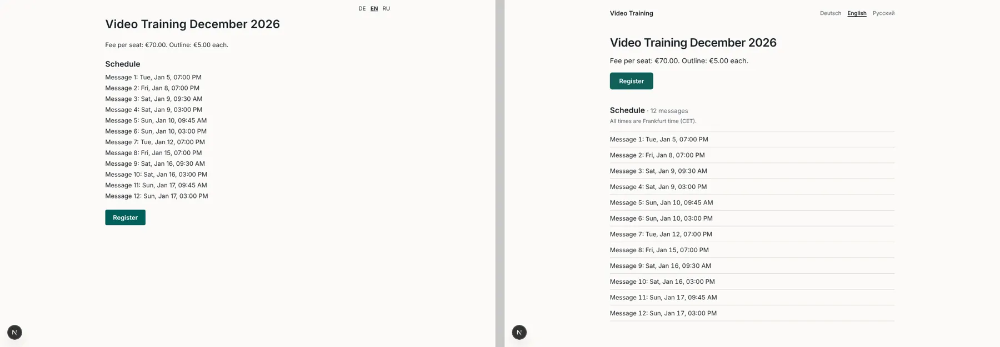

# Impeccable critique and audit, November 2026

The first [Impeccable](https://github.com/pbakaus/impeccable) pass over the platform: `critique` (design review) and `audit` (technical checks). Each screenshot shows the old version on the left and the new one on the right. They were taken with fictional demo data against a stubbed backend.

## Scores before the changes

- **Critique (Nielsen heuristics): 21/40.** The weakest heuristics were error recovery (1) and help (1).
- **Audit: 13/20.** Accessibility 2, performance 3, theming 2, responsive 3, implementation 3.
- **Detector:** `impeccable detect` found 0 issues in `src/` and 0 on the rendered pages, both before and after the changes. The real problems were ones the detector's rules don't cover: unlabelled inputs, input borders with too little contrast, native controls in dark mode, and form state.

## What changed

| Finding | Severity | Change |
| --- | --- | --- |
| A failed submit wiped every typed field. It also reset the seat radio while the part-time list stayed open. The error message appeared off-screen. | P0 | The form now submits through a transition, so React no longer resets it. A part-time registration with no sessions is caught before sending, focus moves to the first session, and an inline message appears. Status messages now sit next to the submit button and receive focus. |
| The success screen hid the payment details. | P1 | The success screen is now a receipt: the total, payee, IBAN and reference with copy buttons, a "check your spam folder" note, and "Register another person". |
| The amount to pay was buried in one small sentence, with no total. A €0 fee from a waiver had no explanation. | P1 | The payment block now lists each amount with a total and labels a waived fee. The free-seat checkboxes sit directly above it, with one line explaining what they do. |
| The coordinator page didn't work on a phone: the payment checkboxes were off-screen at 390px. | P1 | Below `sm`, each registration shows as a card with toggles labelled "Fee paid · €70.00". Waived fees show "Waived" instead of a checkbox. A missing outline count shows in red as "2 missing". A failed payment toggle shows "Not saved" instead of crashing. |
| The login email field and the order quantity inputs had no label. The "OK" buttons and payment checkboxes had ambiguous names. | P1 | Added visible and ARIA labels that name the language or person. "OK" is now a translated "Save". |
| Input borders had too little contrast (1.4:1). The red cancel link was 2.8:1 in dark mode. Native controls stayed light in dark mode. | P1/P2 | Added colour tokens in `globals.css` with a dark-mode set, `color-scheme`, `accent-color`, a themed focus ring and text selection colour. Input borders now reach at least 3:1 in both themes. |
| The form was one flat list of about 17 controls. The rules were collapsed directly above "I have read the rules". | P2 | The form is now grouped into sections (seat, about you, languages, free seat, payment, rules). The rules are shown in full, optional fields are marked, and `autocomplete` is set. Radios and checkboxes are 20px with 44px rows. |
| The language switcher showed "DE EN RU" at 19×20px. | P3 | Each language is now named in itself ("Deutsch · English · Русский"), with `lang` and `hreflang` set and 44px targets. The header shows the app name, linking home. |

## Follow-ups from Jason (2 Nov 2026)

- **Contact people.** The footer and the privacy page list everyone in `CONTACTS` (`"Name <email>; Name <email>"`).
- **Privacy notice.** A typical GDPR notice, in German, English and Russian, at `/[locale]/privacy`. It is a template, not legal advice, and should be reviewed before launch. There is no Impressum yet, because it would need a postal address.
- **Who pays.** An optional "Who sends the bank transfer?" field (`payer_name`, added by a migration) appears on the form. Coordinators see "Paid by …" in their list.
- **Locality.** The form shows the training's locality (`trainings.venue`). The church's name stays out of the public pages.
- **Translation review.** The new German and Russian strings still need a check by a native speaker.

## Next Impeccable steps

- `/impeccable init`: write `PRODUCT.md` with the team (audience, tone, constraints), so later passes have context.
- `/impeccable document`: record the new tokens as `DESIGN.md`.
- After the legal pages and contact details exist, run `/impeccable harden` on the register flow.

